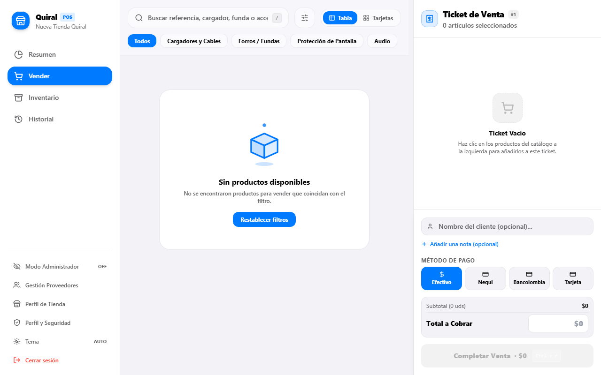
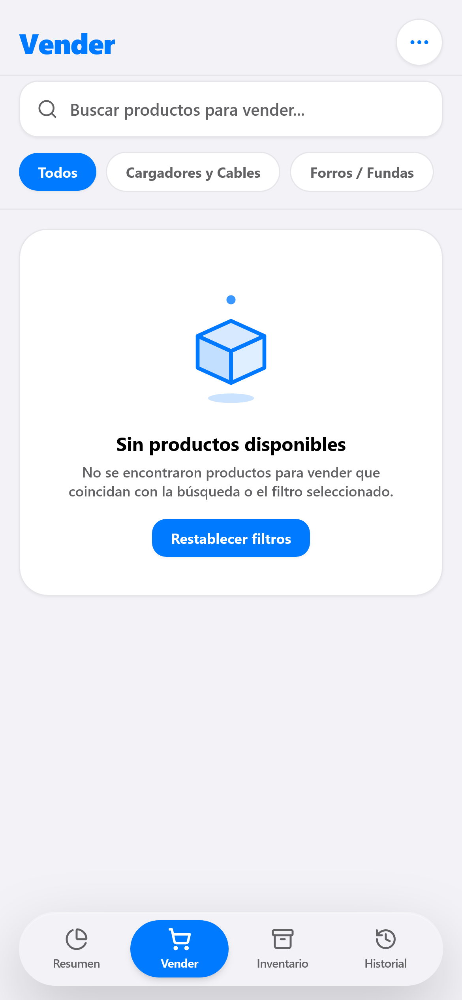
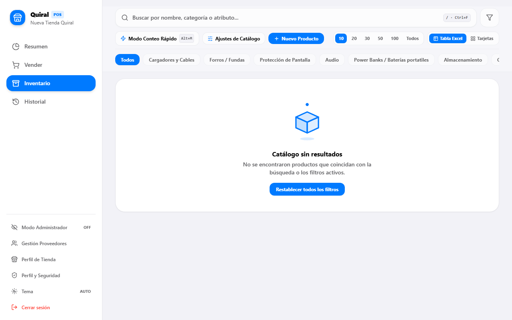
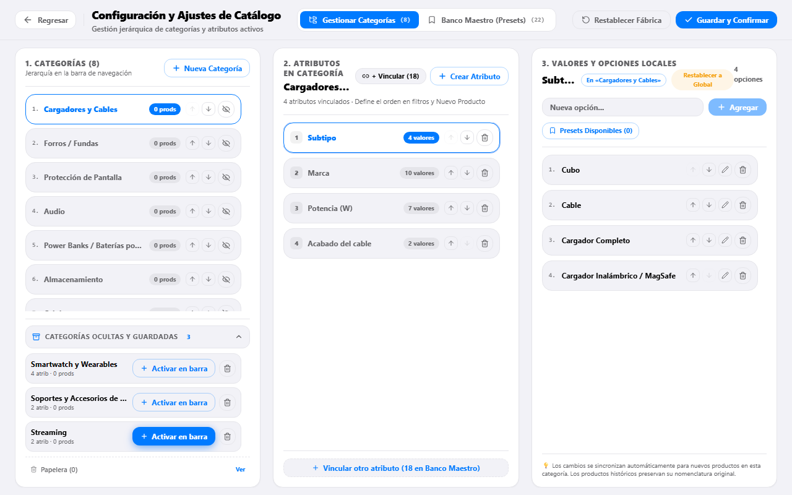
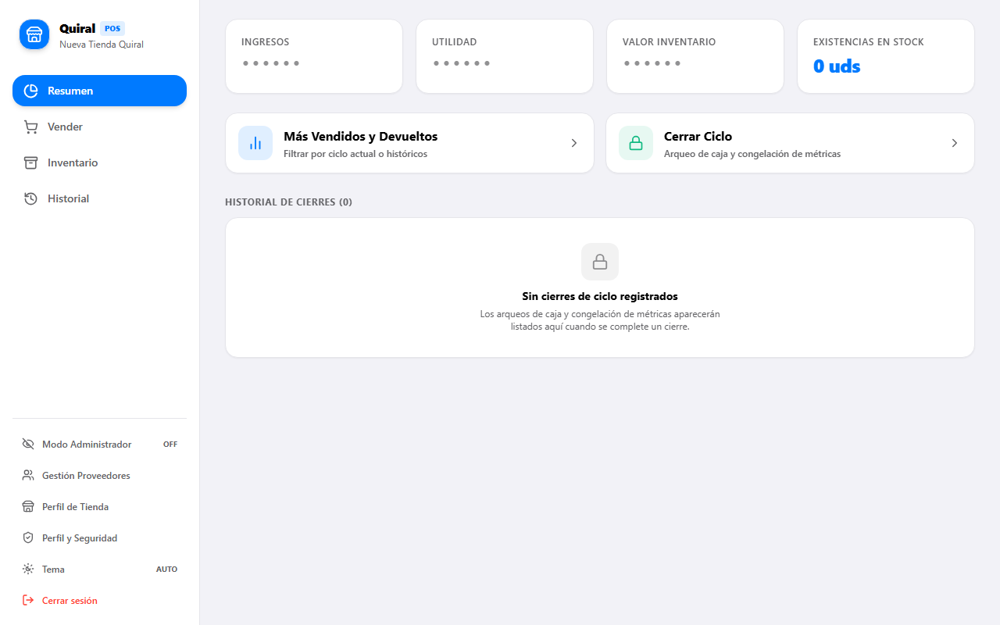

<div align="center">


# Quiral POS — Sistema de Punto de Venta y Gestión de Inventario Minorista

**Velocidad de mostrador en 3 toques, inventario multi-lote con utilidad real al centavo, arqueos de caja inmutables y operación continua con o sin internet.**

[](https://quiral.xyz)
[](https://quiral.xyz)
[-28CD41?style=for-the-badge>)](https://quiral.xyz)
[](https://quiral.xyz)

[**Probar Aplicación en Vivo (quiral.xyz)**](https://quiral.xyz) · [**Galería Visual**](#-galería-visual-y-experiencia-de-usuario) · [**¿Qué Resuelve?**](#-qué-resuelve-quiral-pos) · [**Operación Diaria**](#-flujo-de-uso-del-día-a-día) · [**Especificaciones Técnicas**](#-especificaciones-técnicas-arquitectura-y-seguridad)

</div>

---

## 🏪 Diseñado para el Ritmo Real del Comercio Minorista

**Quiral POS** nació en el mostrador para resolver el problema más costoso de los comercios minoristas (tiendas de tecnología, accesorios para móviles, perfumería y gadgets): **sistemas lentos que hacen fila en la caja e inventarios que mienten sobre las ganancias reales**.

Ya sea cobrando desde un **celular o tablet en el pasillo** o desde una **estación de computador fija con teclado y lector de códigos de barras**, Quiral POS ofrece una experiencia fluida, rápida y libre de fricciones.

---

## 📸 Galería Visual y Experiencia de Usuario

### 📱 1. Venta Rápida de Mostrador (Regla de los 3 Toques)

Atención de mostrador diseñada para cobrar en menos de 5 segundos: busca por referencia, marca o código, selecciona y confirma. Permite pagos combinados (**Efectivo, Nequi, Daviplata, Tarjeta o Mixto**), selección de lote de proveedor específico, descuentos al instante y adición opcional de notas de garantía o nombre del cliente.

<div align="center">

|                         Estación de Mostrador en Escritorio (Desktop)                         |                          Terminal Móvil de Pasillo (Móvil / PWA)                          |
| :-------------------------------------------------------------------------------------------: | :---------------------------------------------------------------------------------------: |
|  |  |

</div>

---

### 💻 2. Estación de Trabajo Desktop de Alta Densidad

Pensada para dueños y cajeros en computadores de mostrador. Cero doble scroll, vista tabular compacta sin desplazamientos horizontales incómodos, ticket de venta lateral en tiempo real y navegación **Keyboard-First** (`/` para enfocar la búsqueda, flechas direccionales y `Ctrl + Enter` para cobrar al vuelo).

<p align="center">
  
</p>

---

### 🎨 3. Personalización Cromática y Modos Visuales (Dual OLED)

Quiral POS se adapta a la identidad visual de tu marca y al confort de tus ojos:

- **5 Paletas de Acento Profesionales:** Azul Clásico, Verde Esmeralda, Púrpura Pro, Naranja Dinámico y Rosa Boutique.
- **Modo Claro y Modo Oscuro Puro (`#000000`):** Cumplimiento estricto de Apple Human Interface Guidelines (HIG). El negro absoluto descansa la vista en turnos nocturnos y ahorra batería en pantallas OLED y iPads.
- **Modo Privacidad en 1 Clic:** Oculta instantáneamente los costos de compra y los márgenes de ganancia (`••••••`) cuando hay clientes mirando la pantalla de caja.

---

### 📦 4. Inventario Inteligente por Lotes Reales

A diferencia de los sistemas anticuados que mezclan los precios de compra con promedios inexactos, Quiral POS rastrea cada entrada de inventario como un lote individual:

- **Trazabilidad por lote:** Cada compra conserva su costo unitario exacto, fecha de ingreso, proveedor asignado y unidades disponibles.
- **Ganancia neta real:** Al vender un producto, el sistema descuenta del lote correspondiente y calcula el margen de utilidad exacto al centavo.
- **Catálogo Vivo y Banco de Atributos:** Crea categorías (_Protectores de Pantalla, Smartwatches, Cargadores, Audio, Perfumería_) y asocia atributos dinámicos con generación automática de nombres comerciales.

<p align="center">
  
</p>

---

### 🔒 5. Cierres de Caja y Arqueos Inmutables

Control financiero blindado al finalizar el turno, la quincena o el mes:

- **Arqueo y Congelación de Métricas:** Cierra el ciclo operativo con un solo clic. Los ingresos, costos y ganancias netas quedan congelados con desglose detallado por cada método de pago.
- **Auditoría Transparente:** Registro de observaciones de arqueo para justificar descuadres o sobrantes de caja sin alterar el histórico contable de ventas pasadas.

<p align="center">
  
</p>

---

## 🎯 ¿Qué resuelve Quiral POS?

### 1. ⚡ Venta Ultrarrápida sin Fricciones

- **Cero pantallas de carga lentas:** Búsqueda instantánea por modelo, marca o referencia mientras hablas con el cliente.
- **Ergonomía dual adaptativa:** En teléfonos móviles se maneja cómodamente con una sola mano mediante cápsulas táctiles inferiores; en computadores de mostrador ofrece un panel dividido con ticket lateral y atajos de teclado.

### 2. 📦 Márgenes Reales sin Promedios Falsos

- En el comercio diario, una referencia comprada a principio de mes cuesta distinto a la comprada semanas después o a otro distribuidor.
- Quiral POS liquida cada venta contra el costo real de su lote específico, garantizando que tu utilidad contable coincida exactamente con el dinero en tu bolsillo.

### 3. 🔒 Privacidad Instantánea en Mostrador

- Un cliente asomado al mostrador jamás verá cuánto te costó la mercancía ni cuánto te estás ganando: activa el **Modo Privacidad** con un toque y censura todas las cifras sensibles.

### 4. 🧩 Catálogo Personalizable sin Depender de Programadores

- Modifica categorías, marcas y atributos al vuelo. El asistente construye automáticamente nombres comerciales claros para tickets térmicos y subtítulos técnicos para el cajero.

---

## 🔄 Flujo de Uso del Día a Día

### Paso 1: Registrar un Producto en 15 Segundos

1. Entra a **Inventario** y pulsa **`+ Nuevo Producto`** (o utiliza la fila de creación rápida estilo Excel en PC).
2. Selecciona la **Categoría** y toca los **Atributos** deseados (ej. _Cubo · 20W · Tipo C · Apple_): el título se autogenera de inmediato.
3. Asigna el **Precio de Venta ($ COP)**, el **Costo de Compra**, las **Unidades iniciales** y el **Proveedor**.
4. Guarda y el producto estará disponible de inmediato en todas las cajas de tu tienda.

### Paso 2: Cobrar una Venta en Mostrador

1. En la vista **Vender (POS)**, busca o toca los artículos que lleva el comprador.
2. Si deseas otorgar un descuento o seleccionar un lote de un proveedor específico, hazlo directamente en el ticket.
3. Elige el medio de pago (**Efectivo, Nequi, Daviplata, Tarjeta o Mixto**), añade el nombre del cliente o una nota de garantía y confirma en **`Cobrar`**.
4. El stock se descuenta en tiempo real en todos tus dispositivos.

### Paso 3: Historial, Garantías y Devoluciones Seguras

1. En **Historial**, consulta ventas pasadas filtradas por fecha, cliente, comprobante o método de pago.
2. **Control de Garantías:** Registra anotaciones técnicas de servicio posventa sin corromper el balance histórico.
3. **Devoluciones con Reconciliación de Stock:** Si anulas o ajustas una venta, **Quiral POS devuelve automáticamente las unidades al lote original**, manteniendo tu bodega 100% cuadrada.

---

## 📊 Comparativa Operativa en Tienda

| Capacidad Comercial                        |  Cuaderno / Hoja de Cálculo  |   POS Tradicional Antiguo    |               **Quiral POS**               |
| :----------------------------------------- | :--------------------------: | :--------------------------: | :----------------------------------------: |
| **Tiempo promedio para cobrar**            |        2 a 3 minutos         |  45 segundos (menús lentos)  | **< 5 segundos (3 toques o `Ctrl+Enter`)** |
| **Control de costos por lote y proveedor** | ❌ Manual y propenso a error | ❌ Promedio simple inexacto  |    **✅ Multi-lote real por proveedor**    |
| **Operación si se cae el internet**        |         ✅ En papel          |    ❌ Se bloquea la caja     |    **✅ Modo Offline-First automático**    |
| **Uso simultáneo en celular y PC**         |       ❌ No disponible       |   ❌ Solo computador fijo    |    **✅ Sincronización en tiempo real**    |
| **Privacidad de costos frente al cliente** |      ❌ Todo a la vista      |  ⚠️ Requiere cerrar sesión   |    **✅ Censura instantánea en 1 clic**    |
| **Personalización de catálogo**            |   ⚠️ Desorden en columnas    | ❌ Rígido / Requiere soporte | **✅ Banco de atributos vivo y flexible**  |

---

## 🗺️ Roadmap 2026–2027 (El Futuro del Producto)

- [ ] **Módulo de Facturación Electrónica DIAN (Colombia):** Emisión directa de factura electrónica y documento equivalente POS conectado con proveedores tecnológicos autorizados.
- [ ] **Sincronización Multi-Sucursal y Traslados entre Bodegas:** Control unificado para negocios con 2 o más sedes físicas, remisiones internas de mercancía y consolidado administrativo.
- [ ] **Aplicación Nativa con Impresión Térmica Bluetooth / USB:** Envío directo a impresoras de 58mm y 80mm sin cuadros de diálogo del navegador y apertura automática de cajón monedero.
- [ ] **Alertas Predictivas de Reabastecimiento:** Notificaciones automáticas cuando las referencias de mayor rotación alcancen su nivel crítico de existencias.

---

<details>
<summary><strong>🛠️ Especificaciones Técnicas, Arquitectura y Seguridad (Documentación para Desarrolladores)</strong></summary>

<br />

### 1. Stack Tecnológico de Alto Rendimiento

| Capa                         | Tecnología                                   | Propósito en Producción                                                                                                             |
| :--------------------------- | :------------------------------------------- | :---------------------------------------------------------------------------------------------------------------------------------- |
| **Frontend Core**            | React 18.3 + TypeScript 5.7 (`strict: true`) | Interfaz reactiva con tipado estático estricto (cero `any`) y desacoplamiento físico de vistas (`Platform Split` Móvil vs Desktop). |
| **Sistema de Diseño**        | Tailwind CSS 3.4 + Tokens Dual OLED          | Paleta adaptativa de alto contraste (`#000000` en modo oscuro OLED, `#F2F2F7` en modo claro) bajo Apple HIG.                        |
| **Build & Bundler**          | Vite 6                                       | Empaquetado optimizado con _tree-shaking_ estático y eliminación de código de desarrollo en producción.                             |
| **Base de Datos & Backend**  | Supabase (PostgreSQL 15+)                    | Almacenamiento relacional en la nube, procedimientos RPC atómicos y canales de sincronización Realtime.                             |
| **Motor Offline-First**      | Dexie.js (IndexedDB) + TanStack Query v5     | Persistencia local en navegador, caché de catálogo y cola de sincronización diferida de ventas sin conexión.                        |
| **Aseguramiento de Calidad** | Vitest + Playwright E2E                      | Pruebas unitarias sobre cálculos financieros/formateadores y pruebas End-to-End automatizadas (Desktop Chromium + Mobile Safari).   |

---

### 2. Arquitectura de Seguridad y Privacidad de Datos

1. **Autenticación Robusta y Control de Acceso (Whitelist):**
   - Sesiones gestionadas con **Supabase Auth** con contraseñas encriptadas mediante algoritmos estándar de la industria (`bcrypt` / `argon2`).
   - **Whitelist de Registro (`src/config/authWhitelist.ts`):** El alta de nuevas tiendas y cuentas en producción está protegida por una lista de control de acceso (ACL) administrativa por correo y dominio autorizado, bloqueando el registro de usuarios no autorizados.
   - **Aislamiento Estricto de Entorno Demo:** El atajo de demostración (`30 / 30`) está restringido a nivel de compilación exclusivamente a `import.meta.env.DEV === true`. En compilaciones de producción (`npm run build`), tanto el botón como la autenticación demo quedan completamente eliminados del código final.

2. **Aislamiento Multi-Tenant con Row Level Security (RLS):**
   - Todas las tablas de datos (`stores`, `store_members`, `suppliers`, `products`, `product_batches`, `sales`, `sale_items`, `cycle_closings`) operan con `ROW LEVEL SECURITY` habilitado en PostgreSQL.
   - Cada consulta y mutación valida criptográficamente el JWT del usuario activo mediante la política `auth.uid() IS NOT NULL AND is_store_member(store_id)`, impidiendo el acceso cruzado entre comercios.

3. **Integridad Transaccional ACID y Bloqueo Pesimista:**
   - La liquidación de ventas se ejecuta mediante la función RPC `complete_sale` en PostgreSQL operando como `SECURITY INVOKER` con bloqueo pesimista (`SELECT ... FOR UPDATE`).
   - Evita ventas duplicadas o saldos negativos de existencias incluso cuando dos cajeros cobran la última unidad al mismo tiempo.

4. **Blindaje de Cabeceras HTTP:**
   - Configuración en `vercel.json` con cabeceras de seguridad estrictas: _Content-Security-Policy (CSP)_, _Strict-Transport-Security (HSTS)_, _X-Frame-Options: DENY_, _X-Content-Type-Options: nosniff_, _Referrer-Policy_ y _Permissions-Policy_.
   - El cliente web utiliza exclusivamente la clave anónima pública (`VITE_SUPABASE_ANON_KEY`) sujeta a RLS; ninguna clave privada `service_role` está expuesta en el frontend.

---

### 3. Resiliencia Offline-First

Si se interrumpe la conexión a internet en el establecimiento:

1. **Lectura Continua:** El catálogo de productos, lotes y proveedores se sirve al instante desde la copia local en **IndexedDB (`Dexie.js`)**.
2. **Cola de Ventas Local:** Las ventas realizadas sin conexión se firman localmente, descuentan el stock en memoria y se almacenan de manera segura en el dispositivo.
3. **Sincronización Automática:** En cuanto el dispositivo recupera la conexión a internet (`window.online`), la cola despacha las transacciones acumuladas hacia Supabase en orden cronológico exacto.

---

### 4. Instalación, Desarrollo y Pruebas Locales

#### Requisitos Previos

- **Node.js** `>= 18.0.0` (recomendado `v20 LTS`)
- **npm** `>= 9.0.0`

#### Variables de Entorno (.env)

```env
VITE_SUPABASE_URL=https://tu-proyecto.supabase.co
VITE_SUPABASE_ANON_KEY=tu_clave_anonima_publica_rls
# Opcional: Correos y dominios autorizados en la Whitelist de registro
VITE_AUTH_WHITELIST_EMAILS=propietario@mitienda.com
VITE_AUTH_WHITELIST_DOMAINS=mitienda.com
```

#### Comandos de Ejecución y Suite de Calidad

```bash
# 1. Instalar dependencias
npm install

# 2. Iniciar servidor local (http://localhost:5173)
npm run dev

# 3. Verificación de tipos TypeScript (Estándar 0 errores)
npx tsc --noEmit

# 4. Pruebas unitarias financieras y formateadores (Vitest)
npm run test:unit

# 5. Compilación optimizada de producción
npm run build

# 6. Pruebas End-to-End automatizadas (Playwright: Desktop + Mobile)
npx playwright test
```

</details>

---

<div align="center">
  <sub><strong>Quiral POS v1.0.1</strong> — Sistema de Punto de Venta y Gestión de Inventario Minorista. Creado con rigor de ingeniería y diseño enfocado en la rentabilidad del comercio moderno.</sub>
</div>
