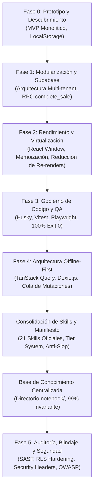

# Historial Cronológico de Fases de Desarrollo — Quiral POS

> **Ubicación:** `notebook/07_HISTORIAL_DE_CAMBIOS_Y_DECISIONES/01_HISTORIAL_DE_FASES.md`  
> **Nivel de Relevancia:** 99% Permanente (Registro Histórico y Genealogía del Proyecto)  
> **Objetivo:** Documentar la evolución arquitectónica, los problemas resueltos y los hitos alcanzados a través de las fases de desarrollo de Quiral POS (`quiral-pwa@1.0.1`).

---

## 1. Cronograma General de Evolución

---

## 2. Detalle de Fases de Desarrollo

### Fase 0: Prototipo Monolítico y Descubrimiento de Campo

- **Objetivo:** Validar la viabilidad de una PWA como punto de venta ágil en pequeños comercios de Colombia.
- **Implementación Inicial:**
  - Componentes monolíticos con persistencia precaria en `localStorage`.
  - Catálogo inicial de productos de retail básico (accesorios, tecnología, cables, cubos de carga).
- **Problemas Detectados en Pruebas de Campo:**
  1. _Fricción en iPhone Safari:_ La barra de navegación inferior y el notch de iOS tapaban botones clave de cobro y navegación.
  2. _Límites de almacenamiento:_ `localStorage` (5 MB) era insuficiente y riesgoso ante borrados accidentales de caché por el navegador.
  3. _Inconsistencia de Inventario:_ Productos con diferentes lotes de compra no podían rastrearse individualmente.
- **Resultado:** Decisión de reescribir la arquitectura hacia un modelo profesional, modular y en la nube.

---

### Fase 1: Modularización y Supabase Multi-Tenant

- **Objetivo:** Desacoplar la lógica de presentación de los servicios de datos y dotar a la plataforma de escalabilidad multi-tienda y seguridad por tenant.
- **Hitos Implementados:**
  - Desacoplamiento en carpetas de módulos autónomos: [`src/modules/pos/`](file:///c:/Users/Sebas/Desktop/elytras/quiral-POS/src/modules/pos/), [`src/modules/inventory/`](file:///c:/Users/Sebas/Desktop/elytras/quiral-POS/src/modules/inventory/), [`src/modules/history/`](file:///c:/Users/Sebas/Desktop/elytras/quiral-POS/src/modules/history/) y [`src/modules/reports/`](file:///c:/Users/Sebas/Desktop/elytras/quiral-POS/src/modules/reports/).
  - Capa de servicios desacoplada en [`src/services/supabase/`](file:///c:/Users/Sebas/Desktop/elytras/quiral-POS/src/services/supabase/) (`products.service.ts`, `sales.service.ts`, `lots.service.ts`, `cashCut.service.ts`).
  - Base de datos PostgreSQL en Supabase con 9 tablas estructuradas e índices de alto rendimiento (`products`, `product_lots`, `sales`, `sale_items`, `customers`, `cash_cuts`, `store_users`, `stores`, `categories`).
  - Políticas de seguridad a nivel de fila (**RLS**) basadas en `store_id` y función de pertenencia `is_store_member(auth.uid(), store_id)`.
  - Función almacenada atómica en PostgreSQL (**RPC `complete_sale`**) para garantizar que el registro de la venta y el descuento de inventario multi-lote ocurran dentro de una transacción ACID indivisible.

---

### Fase 2: Rendimiento, Virtualización y Memorización

- **Objetivo:** Asegurar que la interfaz responda a 60 FPS en dispositivos móviles de gama media y terminales de mostrador con catálogos de cientos de referencias.
- **Hitos Implementados:**
  - Virtualización de listas y catálogos extensos para renderizar exclusivamente los elementos visibles en el viewport.
  - Memorización estricta de cálculos comerciales mediante `useMemo` (cálculo de márgenes de utilidad, impuestos, totales y conteo de existencias).
  - Uso de `React.memo` en tarjetas de catálogo y filas de tickets para evitar re-renderizados innecesarios al teclear en el campo de búsqueda.
  - Optimización de paquetes con Vite para mantener la carga inicial bajo 250 KB (gzipped).

---

### Fase 3: Gobierno de Código, Automatización y QA Riguroso

- **Objetivo:** Eliminar la dependencia de revisiones humanas manuales y blindar los despliegues automáticos a Vercel con el estándar **100% Exit 0**.
- **Hitos Implementados:**
  - Configuración de ganchos de Git (`pre-commit`) con **Husky** y **lint-staged**.
  - Suite de pruebas unitarias ultrarrápidas con **Vitest**:
    - Cálculos financieros deterministas (`financialCalculations.test.ts`).
    - Formateadores universales de pesos y fechas (`domainFormatters.test.ts`).
    - Navegación matricial de catálogo por teclado de escritorio (`matrixKeyboardNavigation.test.ts`).
  - Suite de pruebas End-to-End con **Playwright** en navegadores reales:
    - Pruebas en Desktop Chromium (1280x800).
    - Pruebas en Mobile Safari WebKit (iPhone 13, 390x844).
  - Cobertura de 53 pruebas unitarias y 52 pruebas E2E pasando permanentemente en verde.

---

### Fase 4: Arquitectura Offline-First con TanStack Query y Dexie.js

- **Objetivo:** Permitir que una tienda física continúe cobrando y operando sin interrupción ante cortes de energía o caídas del proveedor de internet.
- **Hitos Implementados:**
  - Implementación de base de datos local en el navegador usando IndexedDB mediante **Dexie.js** ([`src/services/offline/QuiralDexieDB.ts`](file:///c:/Users/Sebas/Desktop/elytras/quiral-POS/src/services/offline/QuiralDexieDB.ts)) replicando el esquema de 9 tablas de Supabase.
  - Cola de mutaciones pendientes (`offline_mutation_queue`) que almacena ventas e inventario creados en modo sin conexión con estado (`PENDING`, `SYNCING`, `SYNCED`, `FAILED`).
  - Integración de **TanStack Query** (`@tanstack/react-query`) con estrategia `networkMode: 'offlineFirst'`.
  - Motor de sincronización en segundo plano ([`src/services/offline/syncEngine.ts`](file:///c:/Users/Sebas/Desktop/elytras/quiral-POS/src/services/offline/syncEngine.ts)) que detecta la recuperación de red (`window.online`) y drena la cola de forma idempotente.

---

### Fase de Consolidación de Skills y Gobierno de Agentes

- **Objetivo:** Ordenar y clasificar el ecosistema de herramientas de IA en el repositorio, eliminando alucinaciones y diseños genéricos de baja calidad (_anti-slop_).
- **Hitos Implementados:**
  - Creación del catálogo unificado de 21 habilidades en [`.agents/SKILLS_INDEX.md`](file:///c:/Users/Sebas/Desktop/elytras/quiral-POS/.agents/SKILLS_INDEX.md).
  - Jerarquización en 3 niveles operativos:
    - **Tier 1 (Núcleo Quiral):** `quiral-ui-hig`, `quiral-pos-engine`, `ui-ux-modern-taste`, `google-stitch`, `stitch-design`.
    - **Tier 2 (Artesanía UI/UX y Testing):** `image-to-code`, `playwright-cli`, `impeccable`, `ui-ux-pro-max`, `ui-styling`, `security-audit`, etc.
    - **Tier 3 (Frameworks Upstream):** `design-taste-frontend`, `web-design-guidelines`, `awesome-design-skills`, `playwright-skill`, `@playwright/mcp`.
  - Publicación del manifiesto de gobierno en [`docs/AGENTS_AND_SKILLS_MANIFESTO.md`](file:///c:/Users/Sebas/Desktop/elytras/quiral-POS/docs/AGENTS_AND_SKILLS_MANIFESTO.md).

---

### Fase de Creación de la Base de Conocimiento Centralizada (`notebook/`)

- **Objetivo:** Construir una biblioteca de documentación permanente, autosuficiente e independiente de cualquier IA, para que cualquier agente o cuaderno (Gemini, Claude, Antigravity) entienda la visión, arquitectura y restricciones del proyecto sin perder contexto.
- **Hitos Implementados:**
  - Estructuración modular en 7 ejes temáticos (`01_VISION_Y_FILOSOFIA`, `02_ARQUITECTURA_Y_SISTEMA`, `03_ESTANDARES_DE_DISENO_Y_UI`, `04_SISTEMA_DE_AGENTES_Y_SKILLS`, `05_INGENIERIA_DE_PROMPTS`, `06_REGLAS_RESTRICCIONES_Y_CALIDAD`, `07_HISTORIAL_DE_CAMBIOS_Y_DECISIONES`).
  - Creación de protocolos bidireccionales de ingeniería de prompts entre Gemini Notebook y Antigravity.
  - Registro de decisiones arquitectónicas formales (ADRs) para preservar el porqué de cada solución técnica.

---

### Fase 5: Auditoría, Blindaje y Seguridad de Datos (Security & Pentesting)

- **Objetivo:** Certificar la protección integral del sistema contra vulnerabilidades OWASP, accesos IDOR, exposición de credenciales y ataques de canal lateral o clickjacking en producción.
- **Hitos Implementados:**
  - **Auditoría SAST y Cero Credenciales Expuestas:** Verificación estricta de ausencia de claves `service_role` o contraseñas en los bundles cliente (`src/`). El cliente solo opera con la clave pública `VITE_SUPABASE_ANON_KEY`.
  - **Validación de Políticas RLS y Prevención de IDOR:** Auditoría con `supabase_mcp` verificando que el 100% de las tablas públicas (`stores`, `products`, `sales`, etc.) mantienen `rowsecurity = true` y validan `auth.uid() IS NOT NULL AND is_store_member(store_id)` tanto en lectura como en mutaciones.
  - **Endurecimiento de Funciones RPC en Supabase:** Revocación de permisos `EXECUTE` al rol `anon` en funciones sensibles (`handle_new_user`, `seed_demo_store`, `update_my_credentials`) para impedir abusos no autenticados en el endpoint REST.
  - **Endurecimiento de Cabeceras HTTP en `vercel.json`:** Configuración de cabeceras de nivel bancario en producción para todas las rutas (`/(.*)`): _Content-Security-Policy (CSP)_, _Strict-Transport-Security (HSTS)_ con 2 años y preload, _X-Frame-Options: DENY_, _X-Content-Type-Options: nosniff_, _Referrer-Policy: strict-origin-when-cross-origin_ y _Permissions-Policy_.
  - **Cero Vulnerabilidades en Dependencias:** Auditoría de paquetes mediante `npm audit` reportando 0 vulnerabilidades.
