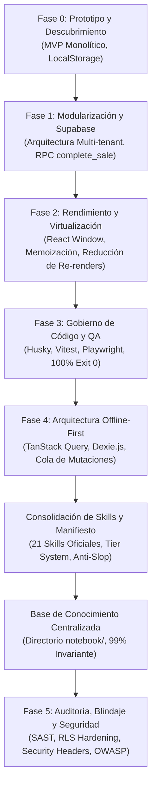

# Historial Cronológico de Fases de Desarrollo — Quiral POS

> **Ubicación:** `notebook/07_HISTORIAL_DE_CAMBIOS_Y_DECISIONES/01_HISTORIAL_DE_FASES.md`  
> **Nivel de Relevancia:** 99% Permanente (Registro Histórico y Genealogía del Proyecto)  
> **Objetivo:** Documentar la evolución arquitectónica, los problemas resueltos y los hitos alcanzados a través de las fases de desarrollo de Quiral POS (`quiral-pwa@1.0.1`).

---

## 1. Cronograma General de Evolución

---

## 2. Detalle de Fases de Desarrollo

### Fase 0: Prototipo Monolítico y Descubrimiento de Campo

- **Objetivo:** Validar la viabilidad de una PWA como punto de venta ágil en pequeños comercios de Colombia.
- **Implementación Inicial:**
  - Componentes monolíticos con persistencia precaria en `localStorage`.
  - Catálogo inicial de productos de retail básico (accesorios, tecnología, cables, cubos de carga).
- **Problemas Detectados en Pruebas de Campo:**
  1. _Fricción en iPhone Safari:_ La barra de navegación inferior y el notch de iOS tapaban botones clave de cobro y navegación.
  2. _Límites de almacenamiento:_ `localStorage` (5 MB) era insuficiente y riesgoso ante borrados accidentales de caché por el navegador.
  3. _Inconsistencia de Inventario:_ Productos con diferentes lotes de compra no podían rastrearse individualmente.
- **Resultado:** Decisión de reescribir la arquitectura hacia un modelo profesional, modular y en la nube.

---

### Fase 1: Modularización y Supabase Multi-Tenant

- **Objetivo:** Desacoplar la lógica de presentación de los servicios de datos y dotar a la plataforma de escalabilidad multi-tienda y seguridad por tenant.
- **Hitos Implementados:**
  - Desacoplamiento en carpetas de módulos autónomos: [`src/modules/pos/`](file:///c:/Users/Sebas/Desktop/elytras/quiral-POS/src/modules/pos/), [`src/modules/inventory/`](file:///c:/Users/Sebas/Desktop/elytras/quiral-POS/src/modules/inventory/), [`src/modules/history/`](file:///c:/Users/Sebas/Desktop/elytras/quiral-POS/src/modules/history/) y [`src/modules/reports/`](file:///c:/Users/Sebas/Desktop/elytras/quiral-POS/src/modules/reports/).
  - Capa de servicios desacoplada en [`src/services/supabase/`](file:///c:/Users/Sebas/Desktop/elytras/quiral-POS/src/services/supabase/) (`products.service.ts`, `sales.service.ts`, `lots.service.ts`, `cashCut.service.ts`).
  - Base de datos PostgreSQL en Supabase con 9 tablas estructuradas e índices de alto rendimiento (`products`, `product_lots`, `sales`, `sale_items`, `customers`, `cash_cuts`, `store_users`, `stores`, `categories`).
  - Políticas de seguridad a nivel de fila (**RLS**) basadas en `store_id` y función de pertenencia `is_store_member(auth.uid(), store_id)`.
  - Función almacenada atómica en PostgreSQL (**RPC `complete_sale`**) para garantizar que el registro de la venta y el descuento de inventario multi-lote ocurran dentro de una transacción ACID indivisible.

---

### Fase 2: Rendimiento, Virtualización y Memorización

- **Objetivo:** Asegurar que la interfaz responda a 60 FPS en dispositivos móviles de gama media y terminales de mostrador con catálogos de cientos de referencias.
- **Hitos Implementados:**
  - Virtualización de listas y catálogos extensos para renderizar exclusivamente los elementos visibles en el viewport.
  - Memorización estricta de cálculos comerciales mediante `useMemo` (cálculo de márgenes de utilidad, impuestos, totales y conteo de existencias).
  - Uso de `React.memo` en tarjetas de catálogo y filas de tickets para evitar re-renderizados innecesarios al teclear en el campo de búsqueda.
  - Optimización de paquetes con Vite para mantener la carga inicial bajo 250 KB (gzipped).

---

### Fase 3: Gobierno de Código, Automatización y QA Riguroso

- **Objetivo:** Eliminar la dependencia de revisiones humanas manuales y blindar los despliegues automáticos a Vercel con el estándar **100% Exit 0**.
- **Hitos Implementados:**
  - Configuración de ganchos de Git (`pre-commit`) con **Husky** y **lint-staged**.
  - Suite de pruebas unitarias ultrarrápidas con **Vitest**:
    - Cálculos financieros deterministas (`financialCalculations.test.ts`).
    - Formateadores universales de pesos y fechas (`domainFormatters.test.ts`).
    - Navegación matricial de catálogo por teclado de escritorio (`matrixKeyboardNavigation.test.ts`).
  - Suite de pruebas End-to-End con **Playwright** en navegadores reales:
    - Pruebas en Desktop Chromium (1280x800).
    - Pruebas en Mobile Safari WebKit (iPhone 13, 390x844).
  - Cobertura de 53 pruebas unitarias y 52 pruebas E2E pasando permanentemente en verde.

---

### Fase 4: Arquitectura Offline-First con TanStack Query y Dexie.js

- **Objetivo:** Permitir que una tienda física continúe cobrando y operando sin interrupción ante cortes de energía o caídas del proveedor de internet.
- **Hitos Implementados:**
  - Implementación de base de datos local en el navegador usando IndexedDB mediante **Dexie.js** ([`src/services/offline/QuiralDexieDB.ts`](file:///c:/Users/Sebas/Desktop/elytras/quiral-POS/src/services/offline/QuiralDexieDB.ts)) replicando el esquema de 9 tablas de Supabase.
  - Cola de mutaciones pendientes (`offline_mutation_queue`) que almacena ventas e inventario creados en modo sin conexión con estado (`PENDING`, `SYNCING`, `SYNCED`, `FAILED`).
  - Integración de **TanStack Query** (`@tanstack/react-query`) con estrategia `networkMode: 'offlineFirst'`.
  - Motor de sincronización en segundo plano ([`src/services/offline/syncEngine.ts`](file:///c:/Users/Sebas/Desktop/elytras/quiral-POS/src/services/offline/syncEngine.ts)) que detecta la recuperación de red (`window.online`) y drena la cola de forma idempotente.

---

### Fase de Consolidación de Skills y Gobierno de Agentes

- **Objetivo:** Ordenar y clasificar el ecosistema de herramientas de IA en el repositorio, eliminando alucinaciones y diseños genéricos de baja calidad (_anti-slop_).
- **Hitos Implementados:**
  - Creación del catálogo unificado de 21 habilidades en [`.agents/SKILLS_INDEX.md`](file:///c:/Users/Sebas/Desktop/elytras/quiral-POS/.agents/SKILLS_INDEX.md).
  - Jerarquización en 3 niveles operativos:
    - **Tier 1 (Núcleo Quiral):** `quiral-ui-hig`, `quiral-pos-engine`, `ui-ux-modern-taste`, `google-stitch`, `stitch-design`.
    - **Tier 2 (Artesanía UI/UX y Testing):** `image-to-code`, `playwright-cli`, `impeccable`, `ui-ux-pro-max`, `ui-styling`, `security-audit`, etc.
    - **Tier 3 (Frameworks Upstream):** `design-taste-frontend`, `web-design-guidelines`, `awesome-design-skills`, `playwright-skill`, `@playwright/mcp`.
  - Publicación del manifiesto de gobierno en [`docs/AGENTS_AND_SKILLS_MANIFESTO.md`](file:///c:/Users/Sebas/Desktop/elytras/quiral-POS/docs/AGENTS_AND_SKILLS_MANIFESTO.md).

---

### Fase de Creación de la Base de Conocimiento Centralizada (`notebook/`)

- **Objetivo:** Construir una biblioteca de documentación permanente, autosuficiente e independiente de cualquier IA, para que cualquier agente o cuaderno (Gemini, Claude, Antigravity) entienda la visión, arquitectura y restricciones del proyecto sin perder contexto.
- **Hitos Implementados:**
  - Estructuración modular en 7 ejes temáticos (`01_VISION_Y_FILOSOFIA`, `02_ARQUITECTURA_Y_SISTEMA`, `03_ESTANDARES_DE_DISENO_Y_UI`, `04_SISTEMA_DE_AGENTES_Y_SKILLS`, `05_INGENIERIA_DE_PROMPTS`, `06_REGLAS_RESTRICCIONES_Y_CALIDAD`, `07_HISTORIAL_DE_CAMBIOS_Y_DECISIONES`).
  - Creación de protocolos bidireccionales de ingeniería de prompts entre Gemini Notebook y Antigravity.
  - Registro de decisiones arquitectónicas formales (ADRs) para preservar el porqué de cada solución técnica.

---

### Fase 5: Auditoría, Blindaje y Seguridad de Datos (Security & Pentesting)

- **Objetivo:** Certificar la protección integral del sistema contra vulnerabilidades OWASP, accesos IDOR, exposición de credenciales y ataques de canal lateral o clickjacking en producción.
- **Hitos Implementados:**
  - **Auditoría SAST y Cero Credenciales Expuestas:** Verificación estricta de ausencia de claves `service_role` o contraseñas en los bundles cliente (`src/`). El cliente solo opera con la clave pública `VITE_SUPABASE_ANON_KEY`.
  - **Validación de Políticas RLS y Prevención de IDOR:** Auditoría con `supabase_mcp` verificando que el 100% de las tablas públicas (`stores`, `products`, `sales`, etc.) mantienen `rowsecurity = true` y validan `auth.uid() IS NOT NULL AND is_store_member(store_id)` tanto en lectura como en mutaciones.
  - **Endurecimiento de Funciones RPC en Supabase:** Revocación de permisos `EXECUTE` al rol `anon` en funciones sensibles (`handle_new_user`, `seed_demo_store`, `update_my_credentials`) para impedir abusos no autenticados en el endpoint REST.
  - **Endurecimiento de Cabeceras HTTP en `vercel.json`:** Configuración de cabeceras de nivel bancario en producción para todas las rutas (`/(.*)`): _Content-Security-Policy (CSP)_, _Strict-Transport-Security (HSTS)_ con 2 años y preload, _X-Frame-Options: DENY_, _X-Content-Type-Options: nosniff_, _Referrer-Policy: strict-origin-when-cross-origin_ y _Permissions-Policy_.
  - **Cero Vulnerabilidades en Dependencias:** Auditoría de paquetes mediante `npm audit` reportando 0 vulnerabilidades.

---

### Fase de Ergonomía Desktop, Nitidez HD y Anti-Halos Cromáticos

- **Objetivo:** Perfeccionar la estación de trabajo de mostrador (>= 768px), erradicando halos de renderizado subpixel y eliminando elementos informales.
- **Hitos Implementados:**
  - **Antialiasing Global y Clase `.antialiased-hd`:** Forzado en `src/index.css` de `-webkit-font-smoothing: antialiased` y `text-rendering: optimizeLegibility`.
  - **Supresión de Aberración Cromática:** Eliminación de texto de acento coloreado translúcido sobre fondos sutiles en pantallas OLED oscuras, sustituyéndolo por texto blanco de alto contraste sobre tarjetas sólidas y pastillas badge sólidas.
  - **Iconografía Profesional:** Erradicación de estrellas y destellos (✨ / `Sparkles`) sustituidos universalmente por `<Zap />` de `lucide-react`.
  - **Ergonomía de Selección en Grilla:** Clic en fila conmuta selección; títulos y enlaces aíslan la apertura de detalles con `e.stopPropagation()`.

---

### Fase de Purga Profunda, Gobernanza de Tokens y Consolidación de Skills

- **Objetivo:** Resolver la saturación del presupuesto de contexto en Antigravity (`25.335 / 20.000 tokens`), eliminando carpetas y archivos residuales sin perder capacidades estéticas ni de base de datos.
- **Hitos Implementados:**
  - **Poda de 78 Carpetas y Archivos Residuales:** Eliminación de 67 carpetas sueltas de estilos, paquetes de documentación legacy de Octubre (`reference/`, 78 archivos) y scripts locales obsoletos (`deploy-assets.sh`).
  - **Enrutador Maestro en `awesome-design-skills`:** Los 67 estilos se preservan íntegros dentro de `skills/<estilo>/` para consulta selectiva sin saturar el contexto de la IA.
  - **Liberación de más de 15.000 Tokens:** Reducción drástica del consumo de personalizaciones al rango seguro (< 45%), reactivando las skills de Supabase, Impeccable y Design Taste.
  - **Enriquecimiento del Núcleo:** Actualización de `quiral-pos-engine` (PostgreSQL RLS, `complete_sale` con `FOR UPDATE`, TanStack Query + Dexie) y `ui-ux-modern-taste` (principios Anti-Slop de ingeniería frontend).

---

### Fase de Optimización Integral: Rendimiento, Ergonomía Táctil Móvil y Búsquedas Diacríticas

- **Objetivo:** Ejecutar la evolución integral del sistema según el mandato de ingeniería senior: optimizar la velocidad y precisión de búsqueda en mostrador, trasladar los presets y aislamiento de catálogo de escritorio a móvil, ampliar los tap targets táctiles y limpiar código huérfano.
- **Hitos Implementados:**
  - **Normalización Diacrítica Universal (`foldDiacritics`):** Función centralizada en `src/utils/formatters.ts` que normaliza y elimina acentos/tildes en tiempo real. Integrada en los filtros de `InventoryView.tsx`, `PosViewDesktop.tsx`, `PosViewMobile.tsx`, `HistoryViewDesktop.tsx` y `HistoryViewMobile.tsx`. Permite a los cajeros y administradores escribir sin preocuparse por tildes (ej. "camara", "bateria", "liquida" encuentran "Cámara", "Batería", "Silicona Líquida").
  - **Transvase Ergonómico Desktop ➔ Mobile (Presets y Scoping):** Adaptación del sistema de Presets Maestros a la vista móvil `AttributeConfigModal.tsx`, mostrando chips dinámicos con icono `Bookmark` que permiten asociar opciones en un toque sin tener que escribirlas manualmente.
  - **Aislamiento de Atributos por Categoría en Móvil:** `AttributeConfigModal.tsx` y `NewProductModal.tsx` ahora operan con aislamiento estricto por categoría (`selectedCategory`), preservando fallback inmediato al banco maestro si la categoría es recién creada.
  - **Ampliación de Tap Targets Táctiles (Apple HIG):** Los controles de edición, reordenamiento y eliminación en `AttributeConfigModal.tsx` se ampliaron a 32-44px con micro-interacciones activas (`active:scale-90`) para evitar pulsaciones fallidas en pantallas táctiles de mostrador.
  - **Limpieza de Código Huérfano:** Eliminación de importaciones residuales (`DesktopAttributeConfigView` en `InventoryView.tsx`) e integración de nombres de proveedores en el índice de búsqueda precalculado.
  - **Certificación de Calidad 100% Exit 0:** 56/56 pruebas unitarias pasando en Vitest, 0 errores en TypeScript estricto, bundle de producción optimizado en Vite y 70/70 pruebas E2E aprobadas en Playwright (Chromium y Mobile Safari).
  - **Persistencia de Paneles de Vinculación y Presets:** En `DesktopCategoryManagerView.tsx`, se configuró la persistencia activa de `link-attr-popover` y `manager-presets-popover` al hacer clic en chips individuales, permitiendo al usuario asociar múltiples atributos y valores consecutivamente sin cierres prematuros, manteniendo cierre explícito mediante botón `(X)` o agotamiento reactivo de opciones.

---

### Fase de Atributos Opcionales en Modal, Clonación Editable y Limpieza Visual de IDs

- **Objetivo:** Refinar la ergonomía de creación y clonación de referencias en la estación de escritorio (>= 768px), garantizar la opcionalidad total de los atributos dinámicos sin contaminación del Banco Global y erradicar la visualización de IDs internos en el catálogo maestro.
- **Hitos Implementados:**
  - **Atributos Dinámicos 100% Opcionales (`DesktopNewProductModal.tsx`):** Supresión de la preselección obligatoria forzada (`opts[0]`). Los chips ahora permiten alternancia activa/inactiva al hacer clic sobre ellos (`toggle`), con botón explícito de "Desmarcar" e indicador contextual `(Opcional)`. La autogeneración de nombre y el subtítulo técnico se construyen única y exclusivamente con los atributos explícitamente elegidos.
  - **Aislamiento Estricto del Banco Global (`InventoryContext.tsx`):** La adición de opciones a un atributo con ámbito de categoría (`categoryName`) enriquece exclusivamente `categoryAttributeValues`, sin mutar ni contaminar `attributes[key].options` en las plantillas del Banco Global Maestro.
  - **Flujo de Clonación Inteligente (`DesktopInventoryGrid.tsx` / `DesktopInventoryGridParts.tsx`):** El botón de clonar `<Copy />` ya no crea productos ciegamente en base de datos. En su lugar, transfiere la referencia hacia `DesktopNewProductModal` con categoría, atributos, costo, precio, proveedor y stock precargados bajo la nomenclatura editable `${nombre} (Copia)`, permitiendo al usuario ajustar cualquier parámetro antes de persistir.
  - **Limpieza de IDs Crudos en Banco Maestro (`DesktopCategoryManagerView.tsx`):** Eliminación de las etiquetas visuales con keys internas (`{attr.key}`) en el listado de atributos maestros, mostrando únicamente el nombre legible y limpio (`attr.label`).
  - **Estandarización de Botones Primarios (`PRIMARY_ACTION_BTN_CLASS`):** Unificación de estilo, curvatura `rounded-xl`, hover glow y micro-interacción `active:scale-95` entre `DesktopCategoryManagerView.tsx` y `DesktopNewProductModal.tsx`.
  - **Certificación 100% Exit 0:** 56/56 pruebas unitarias en verde, compilación limpia en Vite sin errores de TypeScript y 72/72 pruebas E2E aprobadas en Playwright (Chromium y Mobile Safari).

---

### Fase de Refinamiento de Glassmorfismo Real (Liquid Glass) en Modo Claro

- **Objetivo:** Perfeccionar la fidelidad visual de las superficies translúcidas en escritorio (>= 768px), eliminando fondos blancos lechosos u opacos en Modo Claro para permitir que los colores vivos y el contenido del catálogo se filtren nítidamente a través del cristal con desenfoque profundo.
- **Hitos Implementados:**
  - **Barra Flotante Masiva (`DesktopInventoryGrid.tsx`):** Contenedor principal estilizado con `bg-white/35 border border-white/70 text-gray-900 shadow-2xl backdrop-blur-xl backdrop-saturate-150 ring-1 ring-black/5` (y variante dual `dark:bg-black/45 dark:border-white/15 dark:text-white dark:shadow-2xl dark:backdrop-blur-xl dark:ring-white/10`).
  - **Controles Internos Cristalinos:** Selectores de categoría, botones de incremento/decremento de stock (`±1`) y botón de deselección `(X)` adaptados con `bg-white/35 border-gray-200/60 dark:bg-white/10 dark:border-white/15 backdrop-blur-md` y separadores sutiles `bg-gray-300/60 dark:bg-white/15`.
  - **Cabeceras Pegajosas de Catálogo (`InventoryView.tsx` y `PosViewDesktop.tsx`):** Superficies superiores ajustadas a `bg-white/35 backdrop-blur-xl backdrop-saturate-150 border-b border-gray-200/60 dark:bg-black/50 dark:border-white/10 shadow-xs`, con todos sus controles interactivos internos (buscador, filtros, conteo rápido, paginación, alternador de vista y chips de categoría) unificados en `bg-white/40 dark:bg-white/10 backdrop-blur-md`, permitiendo el deslizamiento subyacente de las filas de productos con efecto de cristal esmerilado translúcido de alta saturación óptica.
  - **Aserción E2E Flexible (`tests/desktop-inventory-grid.spec.ts`):** Validación en verde de la aserción `/backdrop-blur-(md|xl)/`.
  - **Certificación 100% Exit 0:** TypeScript estricto sin errores (`tsc`), 56/56 pruebas unitarias en Vitest, compilación limpia de producción en Vite y suite Playwright E2E aprobada (72/72 pruebas).

---

### Fase de Gobernanza de Categorías Activas vs. Ocultas y Panel Colapsable de Categorías Guardadas (Opción A)

- **Objetivo:** Separar arquitectónicamente el concepto de **«Ocultar de la barra activa»** del de **«Purgar definitivamente»**, permitiendo que tanto las categorías de fábrica como las categorías personalizadas creadas por el comerciante (ej. «Gorra», «Reloj») puedan retirarse temporalmente de la barra de navegación sin perder sus atributos ni valores configurados, y reactivarse o eliminarse desde un panel inferior colapsable.
- **Hitos Implementados:**
  - **Capa de Datos y Estado (`src/context/InventoryContext.tsx`):**
    - `hideCategoryFromOrder(categoryName)`: Retira la categoría de `categoryOrder` manteniendo intacto su objeto en `catalogConfig.categories` y sus opciones locales en `categoryAttributeValues`.
    - `restoreCategoryToOrder(categoryName)`: Reinserta la categoría en `categoryOrder` con todos sus atributos y opciones preservados.
    - `deleteCategory(categoryName, fallbackCategory)`: Purga definitiva de `categories`, `categoryOrder` y `categoryAttributeValues`, con confirmación obligatoria de reasignación si existen productos huérfanos asociados.
  - **Estación de Configuración de Catálogo (`src/modules/inventory/components/DesktopCategoryManagerView.tsx`):**
    - En la lista de **Categorías Activas (Columna 1)**, el botón destructivo directo fue reemplazado por el botón no destructivo **`Ocultar de la barra`** (`<EyeOff size={13} />`, `active:scale-95`).
    - Se sustituyó la sección fija de respaldo por el acordeón colapsable **`Categorías Ocultas y Guardadas (N)`** (`toggle-hidden-categories-btn`), que permanece compacto por defecto y al desplegarse lista todas las categorías de `catalogConfig.categories` ausentes en `draftOrder`.
    - Cada fila de categoría oculta ofrece dos acciones claras: **`+ Activar en barra`** (reutilizando `BTN_SECONDARY` de `src/constants/uiButtons.ts`) y **`Eliminar definitivamente`** (`<Trash2 size={13} />`).
  - **Certificación 100% Exit 0:** TypeScript estricto sin errores (`tsc`), 56/56 pruebas unitarias en Vitest, compilación limpia en Vite y cobertura E2E en `tests/desktop-inventory-grid.spec.ts` validando ocultación, persistencia de atributos/opciones al reactivar y purga definitiva.

---

### Fase de Sincronización Integral de Categorías Ocultas en Desktop y Móvil con Badge Discreto y Toggle de Filtrado

- **Objetivo:** Garantizar que las categorías ocultadas o archivadas de `categoryOrder` desaparezcan estrictamente de todas las barras de pestañas rápidas tanto en Escritorio como en Móvil (Inventario y POS), mientras que en la pestaña **"Todos"** de Inventario sus productos se distingan con un micro-badge discreto (`Oculta`) y un control secundario para ocultarlos o incluirlos a voluntad.
- **Hitos Implementados:**
  - **Ocultación Estricta en Pestañas Rápidas (`InventoryView.tsx`, `PosViewDesktop.tsx`, `PosViewMobile.tsx`):**
    - Se eliminó la re-inyección automática de categorías desde `products` hacia las barras de navegación. Ahora `HorizontalScrollNav` recibe única y exclusivamente `catalogConfig.categoryOrder` en ambas plataformas.
    - En `PosViewMobile.tsx`, el carrusel horizontal de categorías se estandarizó sobre `HorizontalScrollNav` (`pos-mobile-category-chips-nav`).
  - **Micro-Badge Discreto «Oculta» en Pestaña "Todos" (`DesktopInventoryGridParts.tsx` y `ProductCard.tsx`):**
    - En la tabla de escritorio (`InventoryGridRow`) y en las tarjetas móviles/desktop (`ProductCard`), los productos cuya categoría no figura en `categoryOrder` exhiben el micro-badge `bg-amber-500/10 text-amber-600 dark:text-amber-400 border border-amber-500/20 px-1.5 py-0.5 rounded-md text-[10px] font-bold tabular-nums inline-flex items-center gap-1` con icono `<EyeOff size={11} />` y texto `Oculta`.
  - **Toggle Discreto de Filtrado (`InventoryView.tsx`):**
    - Cuando existen productos pertenecientes a categorías ocultas, la barra de categorías presenta el botón secundario/terciario (`toggle-hidden-category-products-btn`, usando `BTN_TERTIARY` / `BTN_SECONDARY` de `src/constants/uiButtons.ts`) con etiqueta `Ocultar productos archivados (N)` / `Incluir ocultos (N)`.
  - **Selector en Nuevo Producto (`DesktopNewProductModal.tsx`):**
    - Blindaje estricto para que solo puedan asignarse categorías activas en `categoryOrder`, limpiando cualquier preselección si una categoría fue archivada.
  - **Certificación 100% Exit 0:** `npx tsc --noEmit`, `npm run test:unit` (56/56), `npm run build` y `npx playwright test` (72/72 en Chromium y Mobile Safari).
